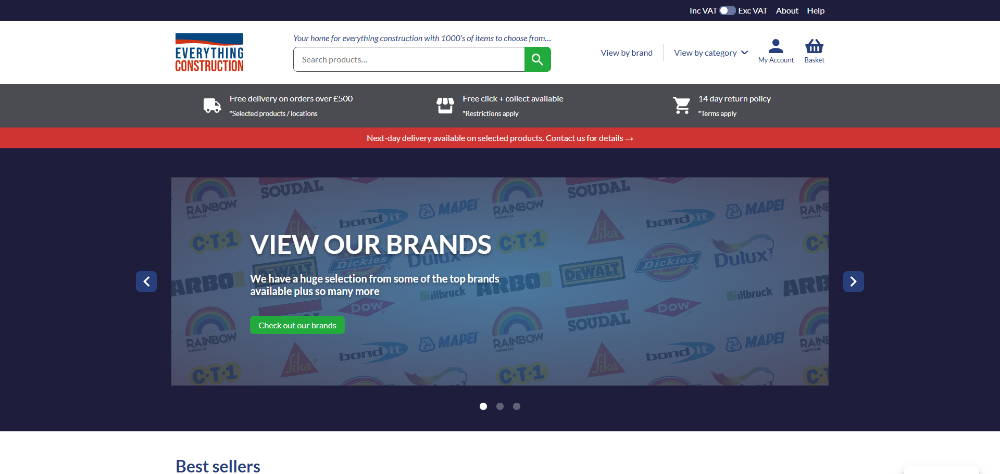

- [Visit site &rarr;](https://everythingconstructionuk.com/)

Everything Construction traditionally sold construction supplies through a brick-and-mortar trade counter location. The opportunity was to bring them into e-commerce without losing what trade customers expected, while opening up a second market of online buyers who'd never normally walk into a trade counter at all.

One main challenge was that trade and DIY customers expect to see completely different prices for the same product. Trade accounts work in ex-VAT pricing, DIY buyers expect the inc-VAT price they're used to seeing everywhere else. The toggle itself is front-end only, so it changes what's displayed, not how WooCommerce actually calculates anything under the hood, which mattered for keeping order totals, tax records, and reporting trustworthy. The harder part was scope: that display decision touches far more of WooCommerce than you'd expect at a glance. Product listings, single product pages, cart and checkout all needed to reflect whichever pricing mode the customer had chosen while keeping order confirmations and emails consistent with clear messaging. The preference is stored in a cookie, so it persists through the whole session as well as during subsequent visits.