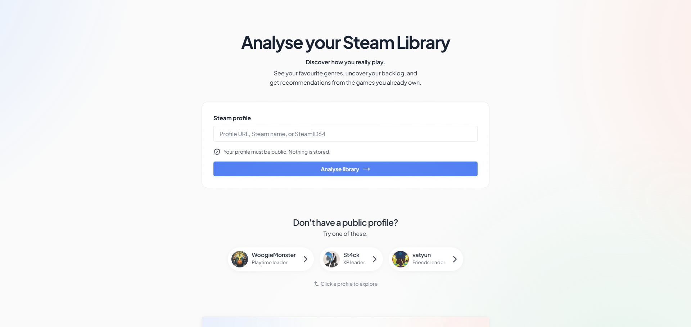
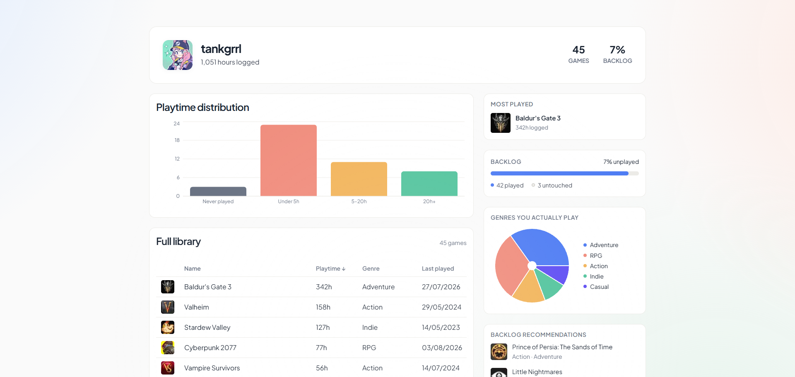
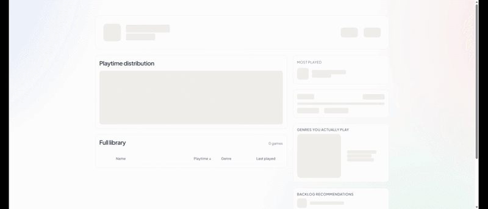

- [View on Github &rarr;](https://github.com/joannahosking/steam)
- [Visit demo &rarr;](https://steam.joannahosking.com/)

I wanted to get more comfortable with React and TypeScript patterns that don't really come up in my client work, things like handling multiple independent data sources loading at different speeds and dealing gracefully with third-party APIs that don't always cooperate. A Steam dashboard felt like a good excuse: pull your owned games, show genre breakdowns and backlog stats, and suggest what to play next from the pile you've never touched.

Steam's own API gives you a library with playtime, but no genre data at all, so genres have to come from somewhere else. I started with *RAWG*, a free games database API, but partway through building this it went down for the better part of two days with no real explanation. That's not something I wanted the whole genre chart depending on, so I switched to Steam's own (undocumented, but stable) store endpoint as the primary source, keyed directly by app ID rather than fuzzy name matching, and kept RAWG around as a fallback for whatever Steam's endpoint can't answer.

Steam's store endpoint is informally rate-limited to roughly 200 requests per 5 minutes, which sounds like plenty until you test against a library with a couple thousand games in it. Enriching everything would blow past that instantly. So enrichment is capped: the most-played games, plus a sample of unplayed ones so the "play next" suggestions have something to work with, run through a small concurrency limiter I wrote so requests go out a few at a time instead of all at once or one by one. Results get cached by app ID too, so popular games (there's always a Stardew Valley or a Baldur's Gate 3 in there) only ever get looked up once, no matter how many different people's libraries include them.

Genre data ended up being the slowest, least reliable part of the whole thing, so I didn't want it holding up everything else. Owned games, genre enrichment, and profile info all load as three separate queries. The stat cards, playtime chart, and full games table show up the moment your library loads, while the genre chart and suggestions sit in their own skeleton state and pop in once they're ready, instead of one spinner blocking the whole page on the slowest piece.